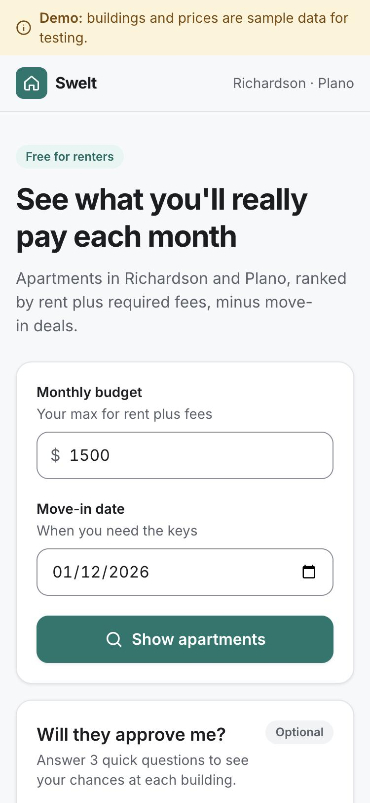
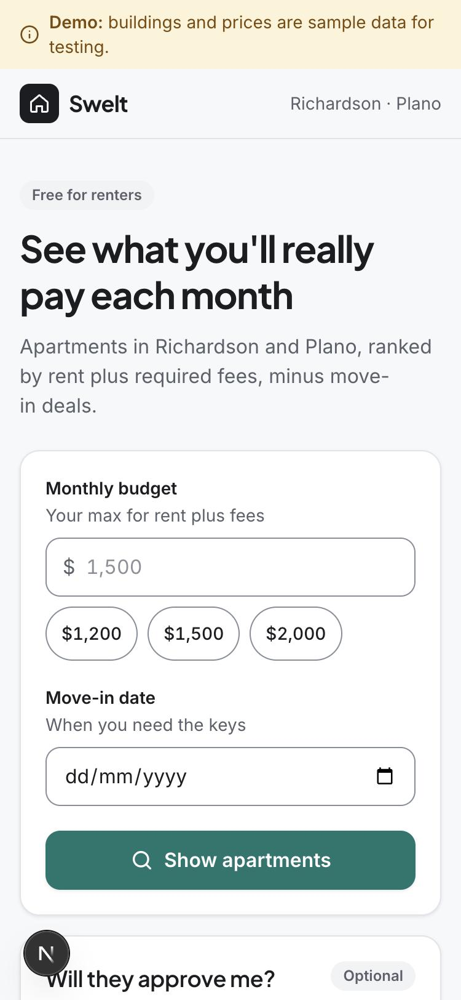
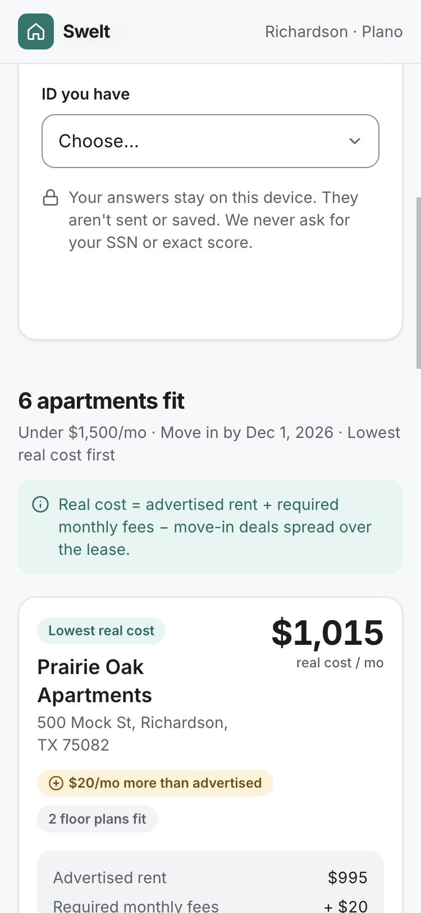
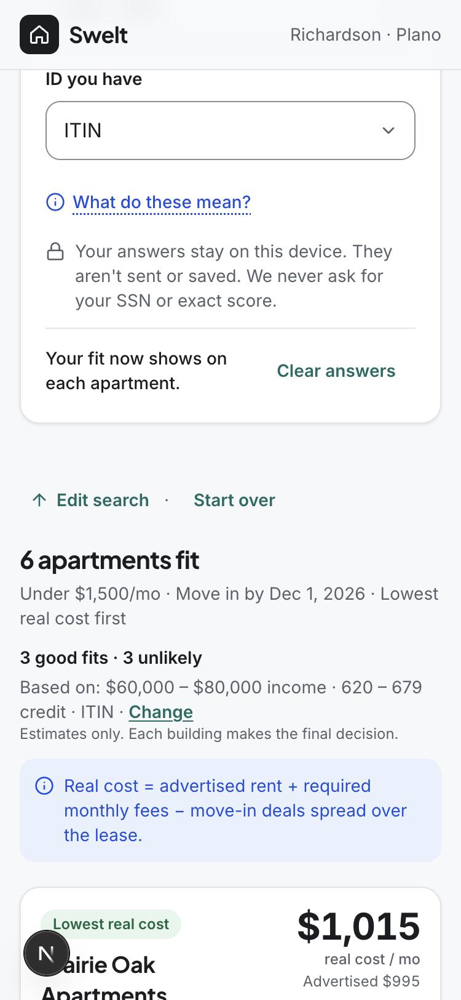
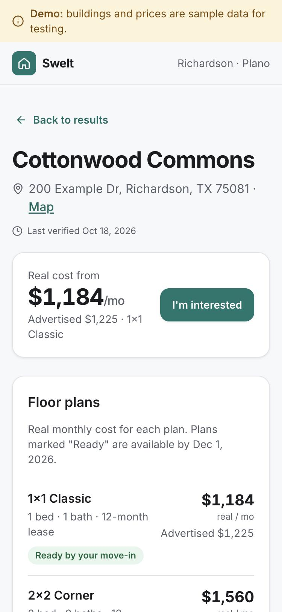
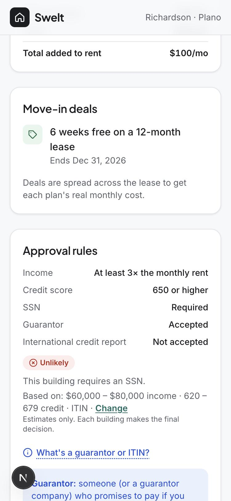
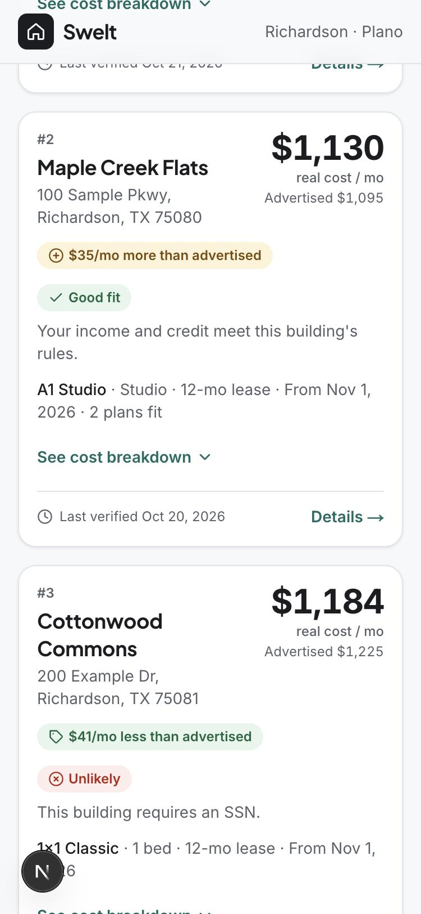
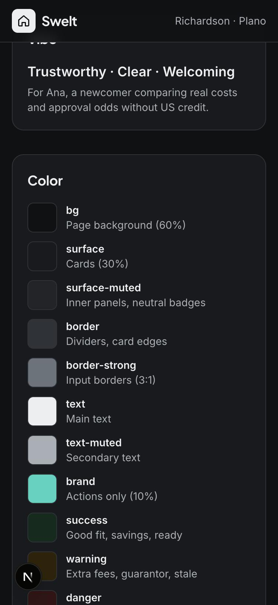

# Design review: October 2026

Swelt's screens were reviewed against two guides:

- **Nielsen's 10 Usability Heuristics** (NN/g)
- **Design Foundations for AI Builders** (Jenny Le, Oct 2026)

Screenshots are at phone width (375px). Files starting `before-` show the live site
before this change; files starting `after-` show it after.

## What changed

| #   | Guide                                                                | Before                                                              | After                                                                                                                               |
| --- | -------------------------------------------------------------------- | ------------------------------------------------------------------- | ----------------------------------------------------------------------------------------------------------------------------------- |
| 1   | Nielsen #9: plain-language errors                                    | Renters could see "Add your Supabase keys to .env.local"            | "Apartments are temporarily unavailable. This is on our side" plus a Try again button. The technical reason is in server logs only. |
| 2   | Nielsen #1: show status                                              | Search button gave no feedback while loading                        | Button shows a spinner and "Searching…"                                                                                             |
| 3   | Nielsen #3: easy exits                                               | No way back to the form except scrolling up                         | "Edit search · Start over" above results and on the "nothing fits" screen                                                           |
| 4   | Nielsen #6: recognition over recall                                  | Fit badges didn't say which answers they used                       | "Based on: $60,000 – $80,000 income · 620 – 679 credit · ITIN · Change" on results and building pages                               |
| 5   | Nielsen #8: only what matters                                        | Cards had up to 3 badges, a 4-line breakdown, plan line and date    | Price (with advertised rent under it), one difference chip, fit, short plan line. Breakdown behind "See cost breakdown".            |
| 6   | Nielsen #10: help in context                                         | ITIN, guarantor and international credit were unexplained           | "What do these mean?" and "What's a guarantor or ITIN?" tips                                                                        |
| 7   | Nielsen #7: shortcuts                                                | Budget had to be typed                                              | $1,200 · $1,500 · $2,000 quick picks                                                                                                |
| 8   | Nielsen #8                                                           | Empty gap at the bottom of "Will they approve me?" before answering | Status row only appears once you answer                                                                                             |
| 9   | Design Foundations: primary color = actions, 60-30-10                | Teal on labels, info box, logo, check icons                         | Teal only on buttons, links and focus. Labels neutral, checks green, logo neutral.                                                  |
| 10  | Design Foundations: semantic colors                                  | Info box was teal                                                   | New blue `info` color (5.9:1 light, 9.0:1 dark contrast)                                                                            |
| 11  | Design Foundations: avoid the "average AI" look                      | Inter everywhere                                                    | Plus Jakarta Sans for headings, Inter for body and prices                                                                           |
| 12  | Design Foundations: people first, vibe words                         | Not written down                                                    | `DESIGN.md`: persona (Ana), problem statement, "Trustworthy · Clear · Welcoming"                                                    |
| 13  | Design Foundations: DESIGN.md + CLAUDE.md + styleguide + review loop | None                                                                | `DESIGN.md`, 3 design rules in `CLAUDE.md`, a `/styleguide` page, and a review-loop rule                                            |

## Screens

| Before                                  | After                                 |
| --------------------------------------- | ------------------------------------- |
|    |    |
|  |  |
|    |    |

Also:  
